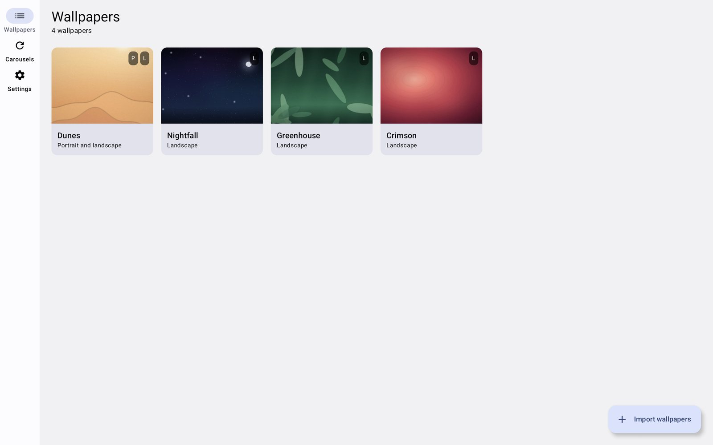
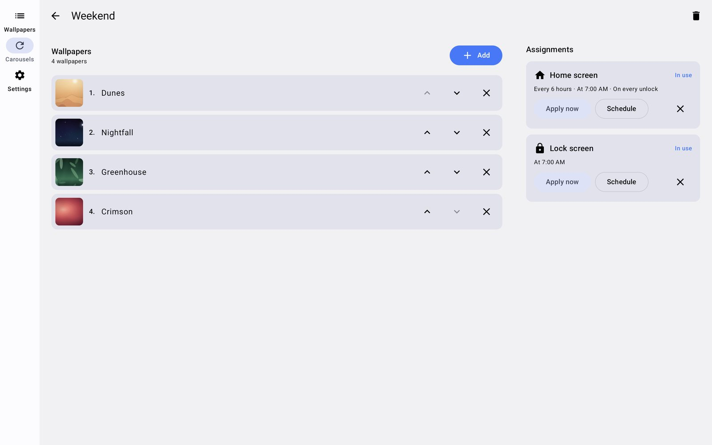
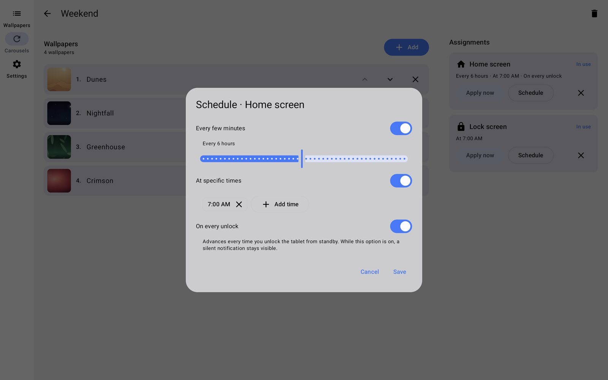
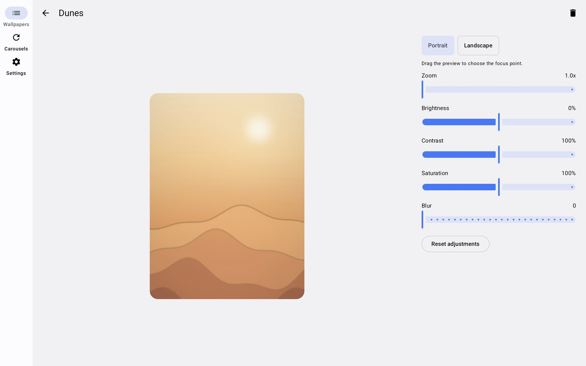

<p align="center">
  
</p>

<h1 align="center">WallCarousel</h1>

<p align="center">
  <b>Rotate home and lock wallpapers on your tablet — offline by default.</b>
</p>

<p align="center">
  <a href="https://github.com/Megaantony00/WallCarousel/releases/latest"></a>
  <a href="LICENSE"></a>
  
</p>

WallCarousel is a lightweight, open-source Android app that rotates the photos you choose on the
home and lock screens of a tablet. It is designed for the Samsung Galaxy Tab S10 FE+ 5G and One UI,
but runs on any device with Android 10 (API 29) or later.

## Screenshots

| Wallpapers | Carousel editor |
|:---:|:---:|
|  |  |
| **Schedule** | **Crop and filters** |
|  |  |

## Download

[**Download the latest APK**](https://github.com/Megaantony00/WallCarousel/releases/latest) - signed,
Android 10 or later.

There are no ads, no analytics and no tracking. The `INTERNET` permission is used only by the
in-app update feature, which reads the latest release from this GitHub repository and downloads
its signed APK. The app works offline if you never check for updates. The F-Droid recipe is kept
in `fdroid/` for a future submission; the app is currently distributed on GitHub.

## Features

- Import photos from the system gallery. No storage permission is requested.
- Keep separate portrait and landscape versions of the same wallpaper, and choose whether each wallpaper is visible in portrait, landscape or both.
- Non-destructive editing: focal point, zoom, brightness, contrast, saturation, blur and blurred bands (dark or light) that keep the whole image visible. Library cards show the rendered result, not the untouched photo.
- Create ordered carousels and assign them to the home screen, the lock screen, or both.
- Combine, independently for each screen, an interval (15 minutes or more), specific times of day
  and an advance on every unlock.
- Advance the wallpaper from two Quick Settings tiles, one for home and one for lock.
- Adaptive Compose UI for tablets, Samsung DeX, split-screen and pop-up view.
- Automatic re-crop on rotation using the saved portrait and landscape versions. It keeps the
  current wallpaper when the new view allows it, otherwise advances to the next visible one; if
  none is visible, the previous image stays centered. The app-side switch is fast; Android still
  takes a moment to write the wallpaper (see limitations).
- Fast wallpaper write as JPEG quality 95 (on by default) with a compact JPEG preload cache, plus a
  bitmap compatibility path. Originals are never modified.
- Optional wallpaper-derived accent palette from the current Home or Lock wallpaper.
- In-app language picker (Follow system, English, Italiano). More languages can be added with a
  `values-xx` translation.
- In-app update: checks GitHub Releases and installs the new signed APK from the app.
- Optional pre-rendering of the next wallpaper, stored as JPEG bytes (uses more CPU, memory and
  battery).

## Current limitations

- A static Android wallpaper stores a single bitmap. WallCarousel re-applies the saved portrait or
  landscape version when the device rotates, using an in-memory JPEG cache. With the fast JPEG
  write the app-side switch measured 0.4-1.0 s per target on the test tablet; writing the bitmap
  through `setBitmap` takes about 2.5-3 s per target and remains available as a compatibility
  option. If the process was killed, the re-apply happens when the app is opened. A lock screen
  that is already visible may keep the old bitmap until the screen is turned off and on.
- Samsung's system-wide Color palette is manual and does not reliably follow wallpaper changes;
  there is no public API for a third-party app to set it. The in-app "Wallpaper palette" only
  themes WallCarousel.
- The in-app language picker changes the app UI; some manifest, Quick Settings tile and
  notification labels can still follow the system language.
- Samsung does not expose third-party live wallpapers on the lock screen. The lock screen is
  static by design.
- WorkManager is inexact by design: scheduled changes can be delayed by Doze and battery
  optimisations. Exact alarms are intentionally not used.
- The unlock schedule needs a small foreground service, because Android does not deliver the
  unlock broadcast to manifest receivers. The service runs only while the option is enabled and
  keeps a silent, ongoing notification visible; disabling the option stops it immediately.
- The DeX desktop wallpaper is managed by One UI and cannot be changed by this app. The app UI
  itself is fully adaptive and works in DeX.
- Lock-screen support depends on the device manufacturer. WallCarousel uses the official
  `WallpaperManager` lock flag and reports an error if the system rejects the change.

See [docs/LIMITATIONS.md](docs/LIMITATIONS.md) for implementation details, measured timings and
ideas for forks (persistent cache, live wallpaper, lower-resolution output, full Material tonal
palette, per-app locales).

## Build

Requirements:

- JDK 21
- Android SDK platform 36 and build-tools 36.0.0
- A `local.properties` file pointing to the SDK, or `ANDROID_HOME` set

```sh
./gradlew :app:assembleDebug
```

The debug APK is written to `app/build/outputs/apk/debug/`.

Run the unit tests with:

```sh
./gradlew :app:testDebugUnitTest
```

### Release build

The release build enables R8 and resource shrinking. Signing is read from a
`keystore.properties` file in the repository root, which is ignored by git:

```properties
storeFile=/absolute/path/to/upload.jks
storePassword=...
keyAlias=...
keyPassword=...
```

```sh
./gradlew :app:assembleRelease
```

Without `keystore.properties` the task still runs and produces an unsigned APK,
which is what the F-Droid build server uses. See [RELEASE.md](RELEASE.md) for the
publication checklist.

## Architecture

- Kotlin, Jetpack Compose and Material 3.
- Single-activity app with an adaptive navigation rail or bottom bar.
- State persisted as JSON in app-private storage with atomic writes.
- Original images copied into app-private storage; edits are stored as a recipe and rendered on
  demand, so the source file is never modified.
- Scheduling through WorkManager only. The interval uses periodic work, daily times use one-time
  work re-enqueued after each run and the unlock trigger uses a foreground service that enqueues a
  single WorkManager run per unlock. A 15 second guard prevents two triggers from advancing the
  same screen at the same moment.
- Quick Settings tiles share the same apply pipeline as the UI.

## Privacy

WallCarousel works offline by default. Photos, metadata and settings never leave the device. If
you enable update checks, the app contacts GitHub only to read the latest release and download its
signed APK. See [PRIVACY.md](PRIVACY.md) for details, including export and deletion.

## License

Copyright (C) 2026 The WallCarousel contributors.

WallCarousel is free software: you can redistribute it and/or modify it under the terms of the
GNU General Public License as published by the Free Software Foundation, either version 3 of the
License, or (at your option) any later version.

See [LICENSE](LICENSE) for the full text.
